<h1 align="center">Link WithU</h1>

<p align="center">
  <strong>
    一款简约的短链管理器
  </strong>
</p>

<p align="center">
  <a href="https://www.rust-lang.org/">
    
  </a>
  <a href="https://hub.docker.com/r/xwithu/link-withu/tags">
    
  </a>
  <a href="https://hub.docker.com/r/xwithu/link-withu">
    
  </a>
</p>

- **极简的管理界面**：零广告，卡片式设计，不被冗余信息淹没，操作更简洁。
- **直观的访问统计**：访问趋势、访问来源、点击排名一目了然，分析更直观。
- **极致的内存占用**：Rust 驱动，平均内存占用仅 4MB，性能没要求。
- **便捷的部署方案**：Docker 一键私有化部署，支持全量数据的导出与导入，迁移更便捷。

## 快速开始

基于 Docker 部署：

```bash
docker run -d \
  --name link-withu \
  -p 5201:5201 \
  -e ADMIN_PASSWORD='<your_password>' \
  -e BASE_URL='<your_server_ip>' \
  -v ./data:/proj/data \
  xwithu/link-withu:latest
```

基于 Docker Compose 部署：

```bash
# 下载 docker-compose.yml 文件
wget https://raw.githubusercontent.com/Explorer-Dong/link-withu/refs/heads/main/docker-compose.yml

# 下载并配置环境变量
wget https://raw.githubusercontent.com/Explorer-Dong/link-withu/refs/heads/main/.env.example -O .env
# 配置密码、域名等参数

# 启动 Link Withu
docker compose up -d
```

环境变量选项：

| 环境变量 | 数据类型 | 默认值 | 变量说明 |
| --- | --- | --- | --- |
| `ADMIN_PASSWORD` | `str` | 无 | 管理员登录密码，生产环境必填 |
| `BASE_URL` | `str` | `http://localhost:5201` | 短链公开地址，例如 `https://go.example.com` |
| `RANDOM_CODE_LENGTH` | `int` | `6` | 随机短码长度，4–16 |
| `TRUSTED_PROXY_COUNT` | `int` | `0` | 可信反代层数。Nginx 反代设为 1，并配置 `proxy_set_header X-Forwarded-For $proxy_add_x_forwarded_for;`；使用 CDN 再加 1 |
| `APP_NAME` | `str` | `Link WithU` | 管理面板名称 |
| `TZ` | `str` | `Asia/Shanghai` | 统计时区，修改后重新创建容器生效 |

## 程序调用

服务提供 HTTP API，支持其他程序及具备 HTTP 工具的 LLM 调用。登录后在设置页生成 API Key，通过 `Authorization: Bearer <API Key>` 调用；重新生成、撤销或修改管理员密码后旧密钥失效。部署后的 `/docs`（Scalar）与 `/redoc` 使用 `/openapi.json` 生成接口文档；文档界面需要连接 jsDelivr。

[在线文档](https://explorer-dong.github.io/link-withu/)可填写部署地址，生成对应的调用命令。

## 界面截图

<details>
<summary>桌面端</summary>
<div align="center">
<table>
<tr>
<td align="center"><b>首页</b></td>
<td align="center"><b>链接</b></td>
<td align="center"><b>设置</b></td>
</tr>
<tr>
<td>
<a href="https://github.com/Explorer-Dong/link-withu/blob/main/.github/assets/analytics.png#gh-light-mode-only">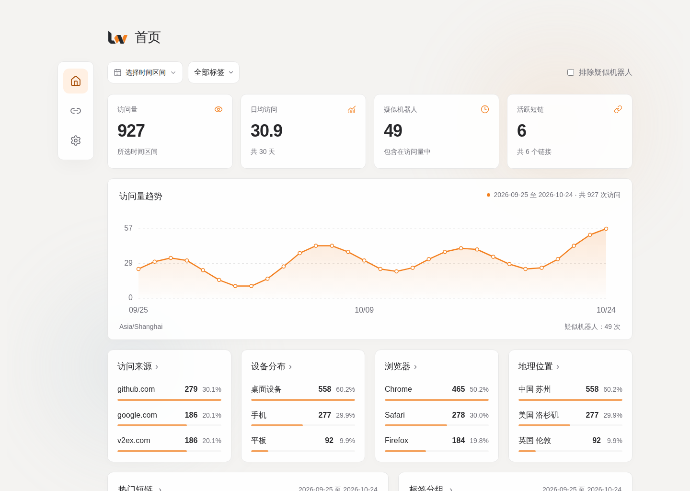</a>
<a href="https://github.com/Explorer-Dong/link-withu/blob/main/.github/assets/analytics-dark.png#gh-dark-mode-only">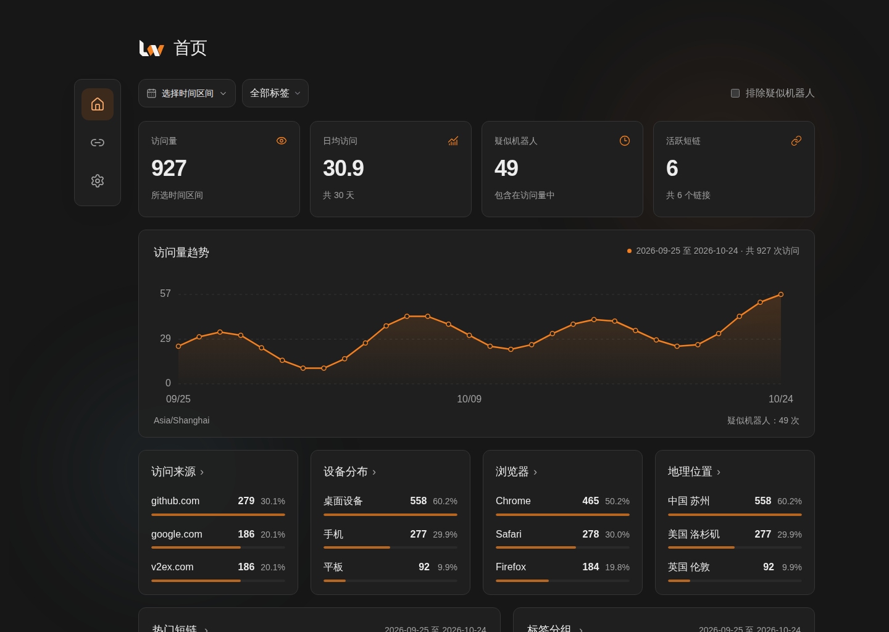</a>
</td>
<td>
<a href="https://github.com/Explorer-Dong/link-withu/blob/main/.github/assets/link-withu.png#gh-light-mode-only">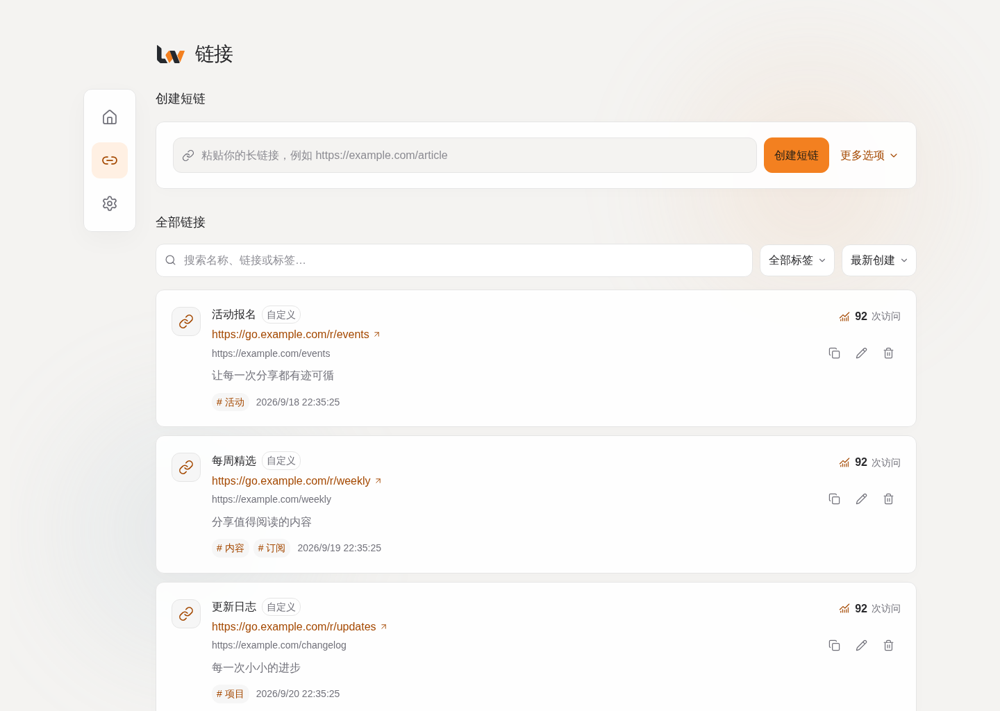</a>
<a href="https://github.com/Explorer-Dong/link-withu/blob/main/.github/assets/link-withu-dark.png#gh-dark-mode-only">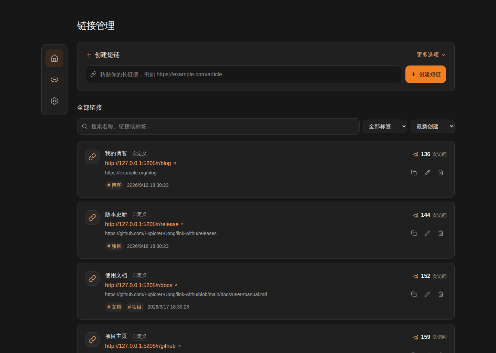</a>
</td>
<td>
<a href="https://github.com/Explorer-Dong/link-withu/blob/main/.github/assets/settings.png#gh-light-mode-only">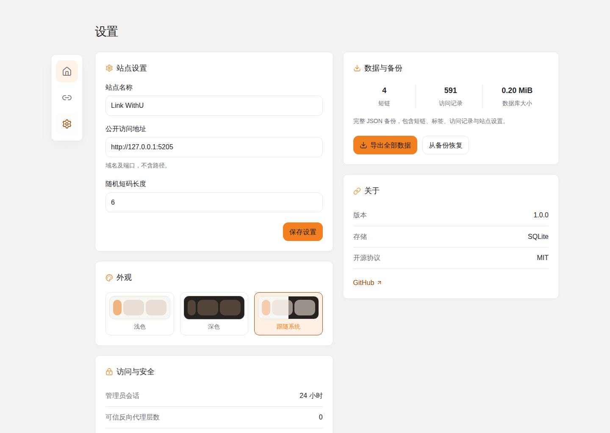</a>
<a href="https://github.com/Explorer-Dong/link-withu/blob/main/.github/assets/settings-dark.png#gh-dark-mode-only">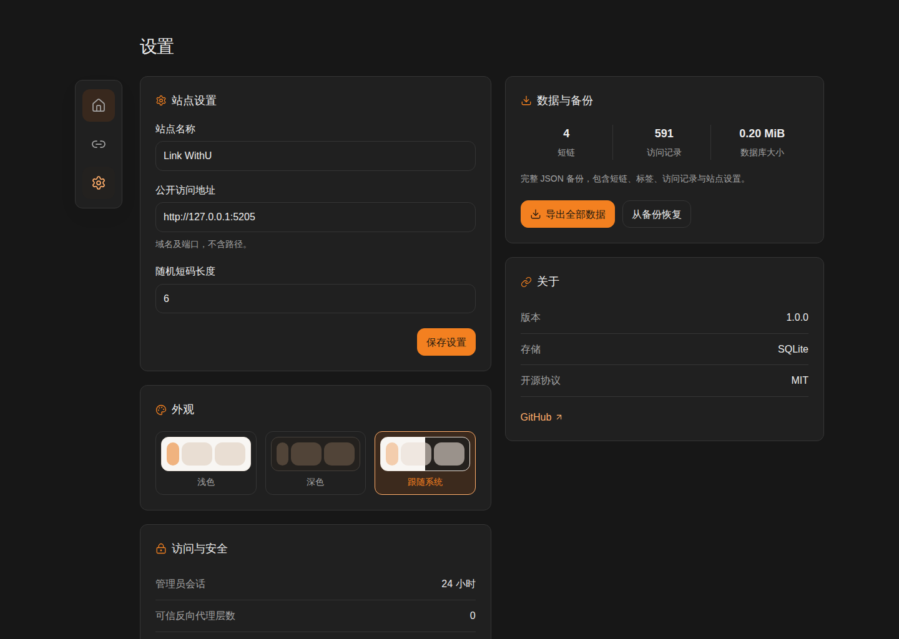</a>
</td>
</tr>
</table>
</div>
</details>


<details>
<summary>移动端</summary>
<div align="center">
<table>
<tr>
<td align="center"><b>首页</b></td>
<td align="center"><b>链接</b></td>
<td align="center"><b>设置</b></td>
</tr>
<tr>
<td>
<a href="https://github.com/Explorer-Dong/link-withu/blob/main/.github/assets/analytics-mobile.png#gh-light-mode-only">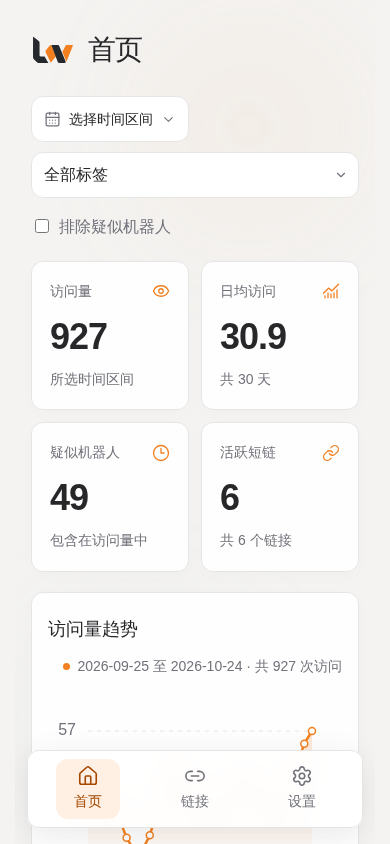</a>
<a href="https://github.com/Explorer-Dong/link-withu/blob/main/.github/assets/analytics-mobile-dark.png#gh-dark-mode-only">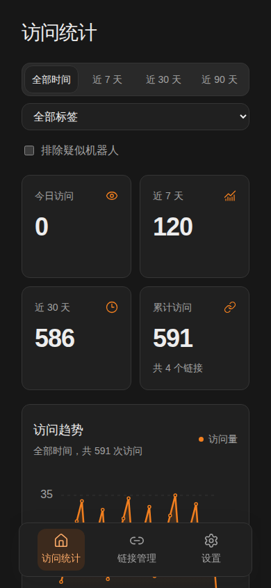</a>
</td>
<td>
<a href="https://github.com/Explorer-Dong/link-withu/blob/main/.github/assets/links-mobile.png#gh-light-mode-only">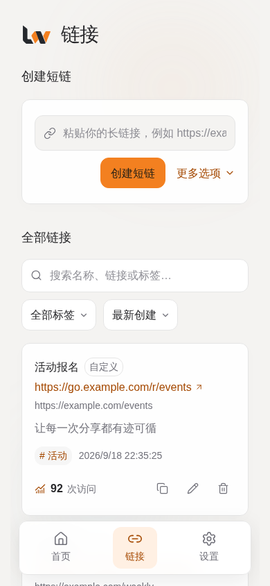</a>
<a href="https://github.com/Explorer-Dong/link-withu/blob/main/.github/assets/links-mobile-dark.png#gh-dark-mode-only">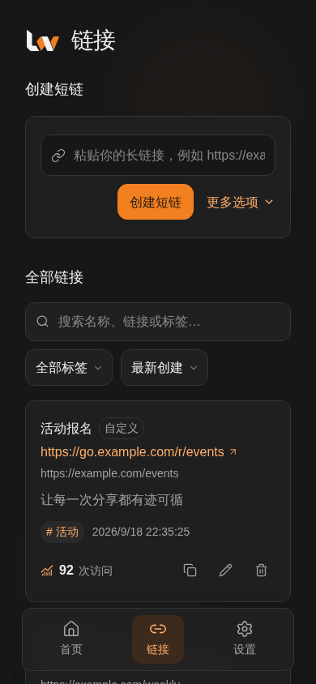</a>
</td>
<td>
<a href="https://github.com/Explorer-Dong/link-withu/blob/main/.github/assets/settings-mobile.png#gh-light-mode-only">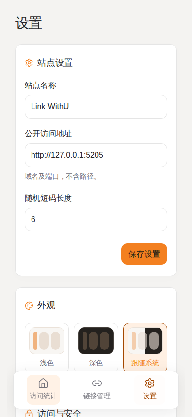</a>
<a href="https://github.com/Explorer-Dong/link-withu/blob/main/.github/assets/settings-mobile-dark.png#gh-dark-mode-only">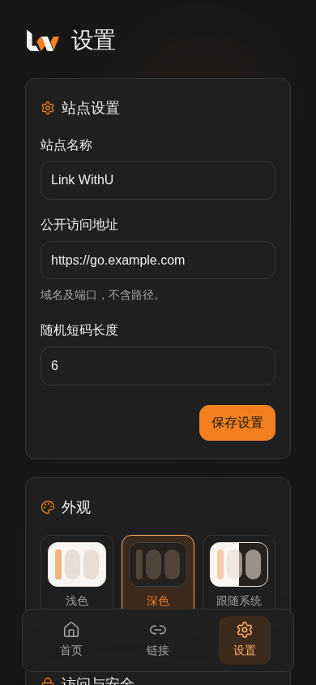</a>
</td>
</tr>
</table>
</div>
</details>

## 参与贡献

[AGENTS.md](./AGENTS.md)

## 开源协议

[MIT](./LICENSE)
